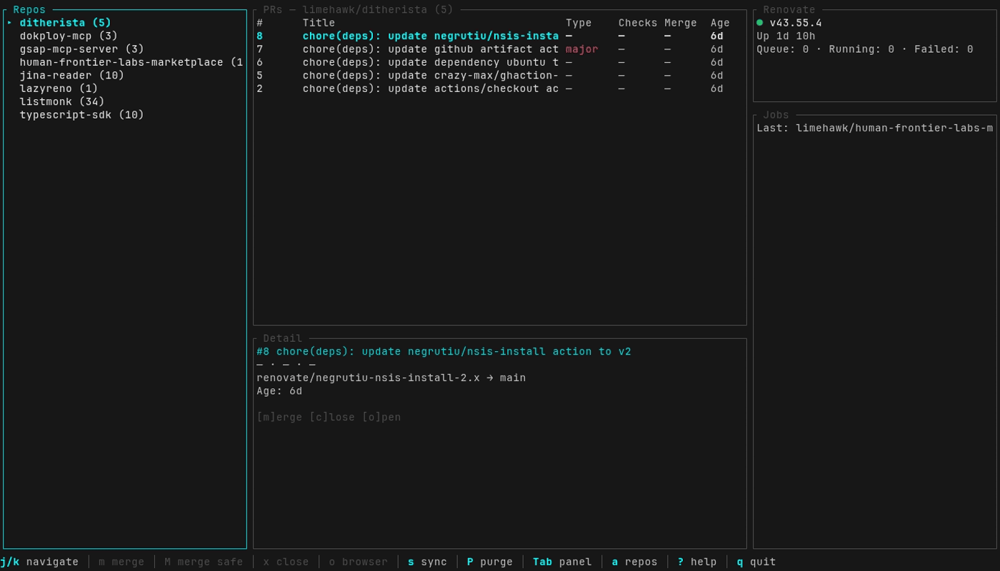

<div align="center">

# lazyreno

A lazy TUI for taming [Renovate CE](https://github.com/mend/renovate-ce-ee) dependency PRs.



[](https://github.com/limehawk/lazyreno/releases)
[](https://aur.archlinux.org/packages/lazyreno)
[](LICENSE)

</div>

---

## Elevator Pitch

Self-hosted Renovate is great until you have 30 repos and wake up to 47 open PRs. You click into GitHub, merge the safe ones, wait for CI, click the next repo, realize half of them need a rebase, go back and comment `/rebase` one by one...

lazyreno puts everything in one keyboard-driven TUI. See every PR across every repo, bulk-merge the safe ones with `M`, rebase the rest with `R`, watch the Renovate job queue drain in real time. No browser tabs. No clicking.

## Features

- **Bento layout** — repo sidebar, PR table + detail, Renovate status + jobs + activity log
- **Bulk merge** — `M` merges all safe PRs (minor/patch, mergeable, checks passing); `A` merges everything
- **Queue-based merging** — handles GitHub's lazy mergeability computation automatically, no repeated retries
- **Renovate commands** — `r` rebase, `e` recreate, `t` retry — posts comments directly to PRs
- **Job monitoring** — live view of running/pending Renovate jobs with queue depth
- **Vim navigation** — `hjkl`, `g`/`G`, `Ctrl+u`/`Ctrl+d`, mouse scroll, context-sensitive hints
- **PR status** — checks pass and mergeable status fetched per PR, displayed in table + detail
- **Fuzzy repo filter** — `a` opens a searchable overlay with scrollbar across all repos
- **Fork filtering** — `f` toggles fork visibility (hidden by default)
- **1Password integration** — `op://` secret references resolved automatically via `op` CLI
- **Auto-refresh** — configurable polling interval with real-time activity log

## Built With

| | |
|---|---|
| [Rust](https://www.rust-lang.org/) 2024 edition | Systems language |
| [ratatui](https://ratatui.rs/) | Terminal UI framework |
| [tokio](https://tokio.rs/) | Async runtime |
| [crossterm](https://github.com/crossterm-rs/crossterm) | Terminal manipulation |
| [reqwest](https://github.com/seanmonstar/reqwest) | HTTP client (native-tls) |
| [clap](https://github.com/clap-rs/clap) | CLI argument parsing |
| [chrono](https://github.com/chronotope/chrono) | Date/time handling |
| [tracing](https://github.com/tokio-rs/tracing) | Structured logging |

## Install

### AUR (Arch Linux)

```bash
yay -S lazyreno
```

### From source

```bash
git clone https://github.com/limehawk/lazyreno.git
cd lazyreno
cargo build --release
cp target/release/lazyreno ~/.local/bin/
```

### Releases

Pre-built binaries on this fork's [releases page](https://github.com/kquinsland01/lazyreno/releases).

The **Release** workflow builds Linux and macOS binaries for x86-64 and ARM64,
and Windows binaries for x86-64. Publishing a release (including a prerelease)
attaches `.tar.gz` archives for Linux/macOS, a `.zip` for Windows, and a
`SHA256SUMS` file. Each archive contains the binary, README, and license.
Linux binaries require glibc 2.39 or newer and OpenSSL 3 (for example, Ubuntu 24.04).

To build without publishing a release, open **Actions → Release → Run workflow**
and select a branch or tag. Download the `lazyreno-<target>` artifacts from the
completed run; they are retained for 14 days and include SHA-256 checksums.

### Container

Releases also publish a Linux amd64/arm64 image to `ghcr.io/<owner>/<repository>`
using the repository running the workflow. Images are tagged with the release
tag and `sha-<full-commit-sha>`; stable releases also update `latest`.
Prereleases do not update `latest`. Manual runs can enable **push_image** to
publish only the commit SHA tag.

For this fork:

```bash
docker run --rm -it \
  --mount type=bind,src="$HOME/.config/lazyreno",dst=/config,readonly \
  -e LAZYRENO_GITHUB_TOKEN -e LAZYRENO_RENOVATE_SECRET \
  ghcr.io/kquinsland01/lazyreno:latest --config /config/config.toml
```

The image runs as UID/GID `10001:10001`; the mounted configuration must be
readable by that user. It includes CA certificates and OpenSSL, but not the
1Password CLI or a browser. Resolve `op://` secrets on the host and pass them
through the environment variables above when using the image.

To build the image locally, run `docker build -t lazyreno .`.
Publishing uses the workflow's built-in `GITHUB_TOKEN` with `packages: write`;
no extra registry secret is needed. Set the GHCR package visibility to public
if you want unauthenticated pulls. The workflow must be merged into the default
branch before its manual trigger appears, and present in the commit being
released for release builds.

## Configuration

Create `~/.config/lazyreno/config.toml`:

```toml
[renovate]
url = "https://your-renovate-instance.example.com"
secret = "your-renovate-api-secret"

[github]
owner = "your-github-org"
token = "your-github-token"

[ui]
refresh_interval = "30s"
accent = "cyan"
```

### 1Password

Secrets can use [1Password secret references](https://developer.1password.com/docs/cli/secret-references/) — resolved automatically:

```toml
[renovate]
secret = "op://Dev/Renovate CE API/credential"

[github]
token = "op://Dev/My GitHub Token/token"
```

### Environment variables

```bash
export LAZYRENO_RENOVATE_SECRET="your-renovate-api-secret"
export LAZYRENO_GITHUB_TOKEN="your-github-token"  # or GITHUB_TOKEN
```

### Renovate CE API setup

Enable the APIs on your Renovate CE instance:

```
MEND_RNV_API_ENABLED=true
MEND_RNV_API_ENABLE_SYSTEM=true
MEND_RNV_API_ENABLE_REPORTING=true
MEND_RNV_API_ENABLE_JOBS=true
RENOVATE_REPOSITORY_CACHE=enabled
```

## Keybindings

### Navigation

| Key | Action |
|---|---|
| `j` / `k` | Move down / up |
| `h` / `l` | Prev / next panel |
| `g` / `G` | Jump to top / bottom |
| `Ctrl+u` / `Ctrl+d` | Half page up / down |
| `Tab` / `Shift+Tab` | Cycle panel focus |
| `Enter` | Focus PR table from sidebar |
| Mouse scroll | Scroll lists (sidebar, PR table, overlays) |

### Actions

| Key | Scope | Action |
|---|---|---|
| `m` | PR table | Merge selected PR |
| `M` | PR table | Merge all safe PRs in repo |
| `A` | PR table / sidebar | Merge all PRs in repo |
| `x` | PR table | Close PR + delete branch |
| `r` | PR table | Rebase PR (`/rebase` comment) |
| `R` | PR table / sidebar | Rebase all PRs in repo |
| `e` | PR table | Recreate PR (`/recreate` comment) |
| `t` | PR table | Retry PR (`/retry` comment) |
| `o` | PR table | Open PR in browser |
| `s` | global | Trigger Renovate sync |
| `P` | global | Purge finished jobs |

### General

| Key | Action |
|---|---|
| `a` | All repos overlay (type to filter) |
| `f` | Toggle fork visibility |
| `?` | Help |
| `q` | Quit |

## License

[MIT](LICENSE)
